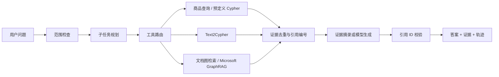

# EvidenceGraph Agent

[](https://github.com/thecatcarryingakeyboard/EvidenceGraphAgent/actions/workflows/ci.yml)
[](LICENSE)

**把业务数据查询、图检索和文档问答连接起来，让回答附带可核查的证据。**

EvidenceGraph Agent 是一个 Python 知识问答项目，围绕电商商品与售后场景，将结构化查询、GraphRAG 和 Agent 工作流组合成可运行的服务。它延续 AssistGen 学习工程中的 LangGraph 多工具编排、Neo4j Text2Cypher 和 Microsoft GraphRAG 查询思路，对工具接口、证据格式、失败处理和发布配置进行重新整理。

默认提供合成商品目录和知识文档，无需密钥、数据库服务器或 GPU 即可体验；需要真实图数据库和大模型时，可以通过独立适配器接入。

## 能解决什么问题

“哪些音箱需要补货，售后保修规则是什么？”包含两类任务：库存应从业务数据查询，保修规则应从文档寻找依据。单一文本检索很难同时保证数值准确、来源清晰和失败可诊断。

本项目将这类问题拆成子任务，根据问题选择工具，再把结果转换为统一证据：

- **结构化事实**：查询商品价格、库存和供应商，支持低库存过滤；
- **文档知识**：通过 BM25 和术语共现图扩展上下文，返回原文片段；
- **图数据库查询**：提供预定义 Cypher 与 Text2Cypher 适配接口；
- **证据约束**：合并重复片段，为回答分配唯一引用 ID；缺失或引用不存在的 ID 时拒答；
- **执行控制**：记录任务、工具、结果与失败回退，并限制同步 Agent 的工具调用次数。

## 快速运行

核心运行环境为 **Python 3.10+**，离线模式只依赖标准库。

```bash
git clone https://github.com/thecatcarryingakeyboard/EvidenceGraphAgent.git
cd EvidenceGraphAgent

# 执行结构化查询 + 文档检索，输出答案、引用和执行轨迹
PYTHONPATH=src python -m enterprise_graphrag.cli agent "比较商品库存并总结售后规则"

# 启动网页和本地 HTTP API
PYTHONPATH=src python -m enterprise_graphrag.cli demo
```

打开 <http://127.0.0.1:8765/>。合成商品中，Mini 库存 42 件，Pro 库存 8 件；“哪些商品需要补货”会执行 `stock < 10` 的参数化查询，只返回 Pro。

也可以安装命令行入口：

```bash
pip install -e .
evidencegraph-agent agent "哪些商品需要补货"
```

### 一次复合查询的结果

以下为上述命令输出的节选，引用内容来自合成数据：

```json
{
  "selected_tools": ["catalog_query", "graph_search"],
  "abstained": false,
  "validation_errors": [],
  "steps": [
    "guardrails", "planner", "tool_selection",
    "catalog_query", "graph_search", "summarize",
    "validate_answer", "final_answer"
  ]
}
```

完整响应还包含商品行记录、`citations`、答案和 `trace`。引用统一为 `[C1]`、`[C2]` 等 ID，可回查文档片段或结构化查询结果。离线 Provider 采用证据摘录；配置模型后才进行模型生成。

## 技术趋势与设计判断

> 资料核对日期：2026-10-27。以下基于上游公开文档与更新记录，说明本项目的设计判断；实验计划与已实现能力分别列出。

**企业知识问答的关键，是在权限、时效和成本约束下，为不同问题找到足够可靠的证据，并让执行过程可检查。** 围绕这一目标，本项目关注以下发展方向。

| 方向与公开进展 | 对企业场景的判断 | 本项目的选择与边界 |
| --- | --- | --- |
| **按问题选择检索策略**：[Microsoft GraphRAG](https://microsoft.github.io/graphrag/query/overview/) 区分实体相关的 Local、社区报告上的 Global、结合社区信息与后续问题的 DRIFT，以及基础向量检索。官方也指出 Global 的资源开销较高。 | 商品库存、单一实体问答和跨文档总结需要不同的数据源与检索范围。图检索的价值应通过关系问题和全局问题验证；简单事实查询应保留低成本路径。 | 当前按子任务路由到参数化商品查询或文档工具，并保留上游查询适配器。后续在同一版本索引上比较检索质量、模型调用量与 P95 延迟，验证何时值得使用 Global / DRIFT。 |
| **混合召回与重排**：[LightRAG](https://github.com/HKUDS/LightRAG) 的 mix 模式组合图与文本向量检索，其更新记录于 2025-08 加入 reranker 支持。 | 图关系补充上下文，向量检索覆盖语义改写，关键词检索保留型号、术语等精确线索；候选集扩大后，还需要控制噪声和上下文长度。增加检索通道是否有效，应由消融实验决定。 | 当前以 BM25 + 术语共现图作为可重复基线。向量召回与 reranker 尚未接入；计划分别比较 BM25、加入向量、加入图扩展和加入重排的收益，并记录额外延迟与成本。 |
| **Agent 的状态与恢复能力**：[LangGraph persistence](https://docs.langchain.com/oss/python/langgraph/persistence) 将线程内 checkpoint 与跨线程 store 分开，为状态检查、故障恢复和人工介入提供基础。 | 多步骤任务需要明确停止条件、失败路径和状态归属。并行可缩短独立任务的等待时间，但持久化恢复还涉及外部调用幂等性、状态保留与访问权限。 | 当前提供同步工具预算与有限回退，以及独立的 LangGraph 并行入口和内存 checkpoint 示例。跨进程恢复、幂等执行和长期记忆仍需单独实现与验证。 |
| **知识生命周期与授权一致性**：LightRAG 已公开增量更新、选择性删除及受影响图关系重建能力。 | 企业知识持续变化；文档删除或权限收紧时，原文、图关系、摘要和缓存都可能留下旧证据。索引新鲜度与授权范围应参与检索设计。 | 当前具备本地 tenant 过滤，导入过程不持久化索引。下一步优先建立文档版本、更新/删除传播和检索前 ACL；请求传入 tenant 不能替代身份认证。 |
| **从引用格式走向语义评测**：LightRAG 的 2025-11 更新记录包含 RAGAS 评测与 Langfuse tracing；[Ragas Faithfulness](https://docs.ragas.io/en/stable/concepts/metrics/available_metrics/faithfulness/) 检查回答中的主张是否由检索上下文支持。 | 检索命中、引用存在和答案可信是不同层次的问题。评测还应覆盖无答案、过期内容和越权问题，并结合人工标注检查自动评测的偏差。 | 当前已实现引用 ID 校验、执行 trace 和合成回归集，尚未接入 Ragas / Langfuse，也未验证语义忠实度。后续将分别衡量检索召回、来源精度、主张支持率、拒答表现与成本。 |

据此，后续实验按三个步骤推进：先建立包含事实查询、关系问答、跨文档总结和无答案问题的版本化评测集；再比较不同召回与重排组合；最后验证更新、删除、权限变化和执行恢复。新组件是否保留，以相同数据与预算下的质量、延迟和维护成本为依据。

## 架构



有两个执行入口：标准库 `AgentRunner` 便于离线运行和调试；可选 LangGraph 工作流使用 `Send` 并行执行子任务，并允许调用方注入 checkpointer。

### 关键设计

| 设计 | 实现与取舍 |
| --- | --- |
| 结构化与文档双通道 | 库存查询使用参数化 SQL；文档通道使用 BM25 与共现图扩展。避免把数值查询仅当作文本匹配。 |
| 统一证据 | SQL 行、Neo4j 行和文档片段均转换为 `Citation`；不同工具产生的同名 ID 在汇总时重新编号。 |
| 有限回退 | 同步 Agent 的主工具报错或没有引用时，最多追加一次文档检索；整个请求默认最多调用 6 次工具。 |
| 查询安全 | Cypher 执行前做保守的只读关键词校验和 `EXPLAIN`，错误反馈给生成器，在限定次数内重试；驱动示例使用读事务和超时。 |
| 可检查的状态 | 响应保留子问题、工具结果、回退事件和引用校验结果；LangGraph 可保存 checkpoint。 |
| 租户过滤 | 本地目录查询、文档检索和证据接口按 tenant 过滤。HTTP 示例允许传入 tenant，仅用于本地实验，认证接入仍需由应用完成。 |

引用校验验证的是 ID 是否存在，**不等同于语义忠实度验证**。本地术语共现图也不等同于上游的实体抽取、社区发现和社区报告。

## 功能状态

| 模块 | 当前状态 |
| --- | --- |
| 商品查询 | 已实现真实 SQLite 参数化查询，使用合成数据，按请求创建并关闭连接。 |
| 本地图检索 | 已实现 BM25、中文双字切分、共现图扩展；`local/global/deep` 分别使用零/一/二轮扩展。 |
| Agent 控制流 | 已实现规则规划与路由、工具预算、失败回退、统一引用和执行轨迹。 |
| LangGraph | 已运行并行 fan-out 和内存 checkpoint 测试；持久化 saver 需另行配置。 |
| Neo4j / Text2Cypher | 已提供读事务客户端、查询执行器、可注入生成器与工具封装，使用假客户端验证拒绝写操作和重试；未声明真实数据库端到端测试通过。 |
| Microsoft GraphRAG | 按 **2.1.0** API 对接 local/global/DRIFT/basic，可读取外部索引项目；参数分派有回归测试，真实索引与模型调用需使用者配置。 |
| 模型 | 离线摘录默认可用；OpenAI-compatible SDK 为可选接入，支持服务方兼容的 endpoint。 |
| 权限与评测 | 本地 tenant 过滤与合成回归集已提供；完整认证、文档 ACL、语义忠实度和公开基准属于后续工作。 |

## API 与文档接入

```bash
curl http://127.0.0.1:8765/v1/agent \
  -H 'Content-Type: application/json' \
  -d '{"query":"比较商品库存并总结售后规则"}'

# 单次文档检索链路
curl http://127.0.0.1:8765/v1/query \
  -H 'Content-Type: application/json' \
  -d '{"query":"没有足够证据时怎么办","mode":"deep"}'

# 临时导入本地 Markdown / txt 并查询；不会持久化索引
PYTHONPATH=src python -m enterprise_graphrag.cli ingest ./demo/knowledge "你的问题"
```

导入文档的来源使用 `documents://相对名称`，响应中不输出本机绝对路径。FastAPI/OpenAPI 入口：

```bash
pip install -e '.[api]'
uvicorn enterprise_graphrag.api:create_app --factory --reload
```

## 可选运行时与集成

### LangGraph 并行与 checkpoint

```bash
pip install -e '.[langgraph]'
PYTHONPATH=src python examples/langgraph_demo.py
```

示例使用 `InMemorySaver`，为每次独立查询生成新的 `thread_id`，并读取保存的状态。同步 Agent 的失败回退和 LangGraph 的并行执行是两个独立入口，当前不宣称行为完全一致。

### Neo4j 与 Text2Cypher

[连接示例](examples/neo4j_demo.py) 展示显式 schema、参数化只读查询、读事务与超时。`Text2CypherExecutor` 接受 `(question, schema, previous_errors) -> statement` 生成器，可接入自己的模型链；本仓库不默认让模型自由执行数据库语句。

```bash
pip install -e '.[neo4j]'
# 先在环境中设置 NEO4J_URI / NEO4J_USERNAME / NEO4J_PASSWORD
PYTHONPATH=src python examples/neo4j_demo.py
```

数据库应使用只读账号。工具封装本身不会自动给任意 Cypher 注入 tenant 条件，多租户部署需通过数据库权限或隔离实例实现。

### Microsoft GraphRAG

使用独立 **Python 3.11/3.12** 环境安装 `.[graphrag]`，自行运行上游索引流程，再按 [接入说明](docs/integrations.md) 加载。上游包作为依赖安装，本仓库不包含其源码、缓存、模型或索引产物。

### 模型服务

`.env.example` 只提供空模板。程序读取进程环境变量，不会自动加载 `.env`：

```bash
pip install -e '.[llm]'
export LLM_PROVIDER=openai_compatible
export LLM_BASE_URL=https://api.deepseek.com/v1
export LLM_MODEL=deepseek-chat
# 使用安全的环境注入方式设置 LLM_API_KEY
```

## 验证与评测

```bash
PYTHONPATH=src python -m unittest discover -s tests -v
PYTHONPATH=src python -m enterprise_graphrag.cli eval --json
python scripts/check_open_source.py --history
```

核心测试不需要外部服务；安装 `.[api,langgraph]` 后会额外执行 API 和 checkpoint 测试。评测中的关键词召回、引用率仅用于合成数据回归，不能作为真实问答准确率或领先其他框架的证据。

## 代码导航

```text
src/enterprise_graphrag/
  agentic.py             # 规划、路由、工具预算、回退、引用校验
  catalog.py             # 实际执行的合成商品目录 SQL
  retrieval.py           # BM25 与共现图扩展
  pipeline.py            # 单次文档查询与耗时 trace
  tools/                 # Neo4j / GraphRAG 工具与行证据转换
  adapters/              # 外部数据库与 GraphRAG API 边界
  workflows/langgraph.py # Send 并行与可注入 checkpoint
  api.py / server.py     # FastAPI / 标准库 HTTP 服务
examples/                # 可选依赖接入示例
tests/                   # 功能、隔离、失败路径回归
docs/                    # 架构、集成、评测和设计说明
```

## 后续方向与来源

本项目优先补齐可验证的工程链路。后续计划包括向量召回与 reranking、增量索引、文档 ACL、持久化 checkpoint、语义忠实度评测和检索成本预算。

- [Microsoft GraphRAG](https://github.com/microsoft/graphrag)：实体、关系、社区报告与多种查询策略。
- [LangGraph](https://github.com/langchain-ai/langgraph)：显式状态、并行子任务与 checkpoint。
- [LightRAG](https://github.com/HKUDS/LightRAG)：混合检索、增量更新和 reranking 的参考方向。
- [RAGFlow](https://github.com/infiniflow/ragflow)：文档解析与检索产品化的参考方向。

设计依据及本次接入核对见 [技术演进说明](docs/design-evolution.md)。贡献方式见 [CONTRIBUTING.md](CONTRIBUTING.md)，第三方说明见 [THIRD_PARTY_NOTICES.md](THIRD_PARTY_NOTICES.md)。本仓库代码采用 [MIT License](LICENSE)。
