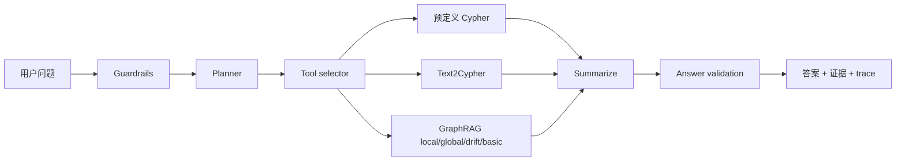

# AssistGen Graph Agent

一个面向面试展示和源码学习的 **LangGraph + Neo4j + Microsoft GraphRAG** 参考项目。

这个项目把企业知识问答里最值得展示的一条链路串起来：

> 用户问题 → 业务护栏 → 任务规划 → 工具选择 → Neo4j 结构化查询 / GraphRAG 文档检索 → 结果汇总 → 答案校验

项目围绕一个合成的电商知识库编写，默认模式不需要 API Key、Neo4j、GPU 或云服务即可运行。安装可选依赖后，可以把同一条工作流接到 DeepSeek、Ollama、OpenAI-compatible 模型、Neo4j 和 Microsoft GraphRAG。

## 为什么做这个项目

普通 RAG 适合“从文档里找一段话”，但企业问题经常同时包含两种查询：

- **结构化事实**：某商品的库存、价格、供应商、订单数量；
- **非结构化知识**：售后规则、故障说明、多个文档之间的总结和比较。

原始 AssistGen 学习项目已经包含了 LangGraph、多工具 Agent、Neo4j Text2Cypher 和 GraphRAG 查询。本仓库将这条学习主线重新整理成一个小而完整的公开示例，重点展示设计取舍和可验证的运行轨迹，而不是把上游项目源码整份复制进来。

## 5 分钟看懂项目



面试时可以按下面的顺序演示：

1. 用 `demo` 命令启动离线服务；
2. 问一个需要文档检索的问题，展示引用片段；
3. 问一个需要结构化数据的问题，展示工具路由和 Cypher 结果；
4. 打开 `docs/architecture.md`，解释失败重试、只读校验和 GraphRAG 适配边界；
5. 运行评测，说明如何验证检索、引用和拒答，而不是只展示一条“看起来正确”的回答。

## 快速开始：无需外部服务

```bash
git clone https://github.com/thecatcarryingakeyboard/enterprise-graphrag-agent.git
cd enterprise-graphrag-agent

# 直接运行离线问答
PYTHONPATH=src python -m enterprise_graphrag.cli ask "上线前需要完成哪些工作？"

# 查看多工具 Agent 的完整步骤
PYTHONPATH=src python -m enterprise_graphrag.cli agent "比较商品库存并总结售后规则"

# 运行确定性回归评测
PYTHONPATH=src python -m enterprise_graphrag.cli eval --json
```

启动无依赖 Demo 服务：

```bash
PYTHONPATH=src python -m enterprise_graphrag.cli demo
```

然后打开 <http://127.0.0.1:8765/>，或调用：

```bash
curl -s http://127.0.0.1:8765/v1/query \
  -H 'content-type: application/json' \
  -d '{"query":"没有足够证据时应该怎么办？","mode":"deep"}'
```

## 运行结果长什么样

每次查询都保留可以追问的结构化信息：

```json
{
  "answer": "…… [C1] ……",
  "citations": [
    {
      "citation_id": "C1",
      "title": "检索增强生成评测规范",
      "quote": "没有足够证据时应拒答或请求补充……",
      "source_uri": "demo://eval"
    }
  ],
  "mode": "deep",
  "trace_id": "…",
  "confidence": 0.82,
  "abstained": false,
  "trace": [
    {"name": "route", "duration_ms": 0.1},
    {"name": "retrieve", "duration_ms": 0.4},
    {"name": "generate", "duration_ms": 0.0}
  ]
}
```

没有可见证据时，系统会返回 `abstained=true`，不会让 Demo Provider 编造一段完整答案。

## 代码如何对应原始学习项目

| 原项目中的学习点 | 公开仓库中的位置 |
| --- | --- |
| LangGraph 状态图 | `src/enterprise_graphrag/workflows/langgraph.py`（可选依赖） |
| Guardrails / Planner / Tool selection | `src/enterprise_graphrag/agentic.py` |
| 预定义查询、Text2Cypher、GraphRAG 三类工具 | `src/enterprise_graphrag/tools/` |
| Neo4j schema-aware 查询和只读安全边界 | `src/enterprise_graphrag/adapters/neo4j.py` |
| GraphRAG local/global/drift/basic 适配 | `src/enterprise_graphrag/adapters/graphrag.py` |
| 证据、引用和答案校验 | `src/enterprise_graphrag/models.py`、`pipeline.py` |
| 评测与回归 | `src/enterprise_graphrag/eval.py`、`tests/` |

默认离线实现故意使用小型内存图和规则路由，便于阅读和调试；安装可选依赖后再替换为真实模型和数据库。这样面试演示不依赖一台已经配置好的服务器，也能清楚说明生产环境的替换点。

## 可选：连接模型、Neo4j 和 GraphRAG

安装开发依赖：

```bash
pip install -e '.[dev,langgraph,llm,neo4j,graphrag]'
```

从环境变量模板开始：

```bash
cp .env.example .env
# 在 shell 或 Secret Manager 中注入真实值，不要提交 .env
```

常见配置包括：

```text
LLM_PROVIDER=openai_compatible
LLM_BASE_URL=https://api.deepseek.com/v1
LLM_API_KEY=...
LLM_MODEL=deepseek-chat

NEO4J_URI=bolt://localhost:7687
NEO4J_USERNAME=neo4j
NEO4J_PASSWORD=...
NEO4J_DATABASE=neo4j

GRAPHRAG_PROJECT_DIR=/path/to/a/graphrag/project
GRAPHRAG_QUERY_TYPE=local
```

Neo4j 查询遵循“生成 → schema 校验 → `EXPLAIN` → 只读执行 → 失败重试”的边界；参数使用参数化查询，禁止 `CREATE`、`DELETE`、`SET`、`DROP` 等写操作。GraphRAG 适配器只负责加载上游生成的索引和统一上下文，不在本仓库 vendoring Microsoft GraphRAG 源码。

## 目录结构

```text
src/enterprise_graphrag/
  agentic.py                 # 无依赖的 Agent 状态、规划和工具路由
  pipeline.py                # 轻量查询链路：route → retrieve → cite → answer
  workflows/langgraph.py     # 可选 LangGraph 状态图
  tools/                     # predefined Cypher、Text2Cypher、GraphRAG 工具
  adapters/                  # Neo4j、Microsoft GraphRAG 等外部适配器
  models.py                  # Query、Evidence、Citation 等稳定数据契约
  eval.py                    # 离线回归评测
tests/                       # 不依赖外部服务的测试
docs/                        # 架构、面试演示、评测和发布说明
```

## 测试与质量检查

```bash
PYTHONPATH=src python -m unittest discover -s tests -v
python -m compileall -q src
python scripts/check_open_source.py
ruff check src tests
git diff --check
```

## 面试展示时可以主动说明的边界

- 这是学习型参考实现，不声称可以直接承担生产流量；
- 离线模式的规则 Planner/Router 是为了可重复演示，真实部署可替换为结构化 LLM 输出；
- GraphRAG、Neo4j、LangGraph 和模型 SDK 都是可选依赖，版本和索引格式应由部署方锁定；
- 评测样例是合成数据，接入真实企业文档前需要重新建立权限、数据脱敏和人工验收流程。

## 前沿方向与参考项目

本项目的设计取舍参考了公开项目的工程思路，代码保持独立：

- [Microsoft GraphRAG](https://github.com/microsoft/graphrag)：local/global/DRIFT/basic 查询与社区摘要；
- [LightRAG](https://github.com/HKUDS/LightRAG)：双层图与向量检索、增量更新；
- [KAG](https://github.com/OpenSPG/KAG)：schema 和逻辑推理；
- [RAGFlow](https://github.com/infiniflow/ragflow)：文档解析和可视化 RAG；
- [LangGraph](https://github.com/langchain-ai/langgraph)：checkpoint、interrupt、Send 并行和 durable execution；
- [MCP servers](https://github.com/modelcontextprotocol/servers)：工具、资源和权限边界；
- [Ragas](https://github.com/explodinggradients/ragas) / [DeepEval](https://github.com/confident-ai/deepeval)：检索和答案评测；
- [Phoenix](https://github.com/Arize-ai/phoenix) / [Langfuse](https://github.com/langfuse/langfuse)：trace 与可观测性。

上游许可证和本项目的使用边界见 [THIRD_PARTY_NOTICES.md](THIRD_PARTY_NOTICES.md)。本仓库自己的代码采用 [MIT License](LICENSE)。

## 贡献

欢迎提交 Issue 和 Pull Request。新增工具或适配器时，请同时补充最小可运行示例、失败路径、权限影响和评测变化。贡献前请阅读 [CONTRIBUTING.md](CONTRIBUTING.md) 与 [SECURITY.md](SECURITY.md)。
