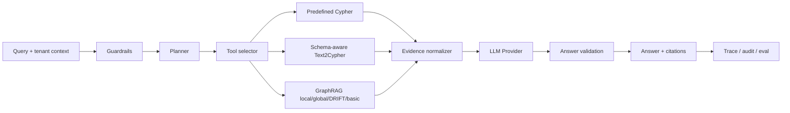

# EvidenceGraph Agent

面向企业知识库的证据驱动 GraphRAG Agent 参考实现。

EvidenceGraph Agent 将租户隔离、混合检索、知识图谱扩展、引用链、拒答策略、工具治理和评测放进一条可运行的查询链路。项目默认使用合成数据和离线 Demo Provider，克隆后无需 API Key、数据库或 GPU 即可运行；生产环境可以替换为 OpenAI-compatible 模型、PostgreSQL/pgvector、Neo4j、Microsoft GraphRAG 和 OpenTelemetry。

> 这是一个可阅读、可测试、可扩展的工程参考实现，不代表任何厂商的官方产品，也不承诺开箱即用的生产部署。

## 项目解决什么问题

普通 RAG 适合从文档中寻找相关片段，企业问题还经常需要结构化查询、跨文档总结和多跳关系推理。系统需要同时回答以下问题：

- 回答来自哪个文档、哪个片段，能否被复核；
- 一个租户能否看到另一个租户的知识；
- 没有证据时是否会明确拒答；
- 结构化查询是否只读、是否经过 schema 校验；
- 检索质量、延迟、成本和工具轨迹能否持续评测。

本项目把这些约束设计成稳定的数据结构和适配器接口，方便替换模型、索引和数据库，而不改变上层 Agent 流程。

## 核心能力

| 能力 | 说明 |
| --- | --- |
| Local / Global / Deep | 直接事实检索、图关系扩展、多跳检索三种模式 |
| 多工具 Agent | Guardrails、Planner、Tool selection、结果汇总和答案校验 |
| Hybrid Retrieval | 词法召回与实体共现图扩展，并返回检索原因和分数 |
| Predefined Cypher | 高频结构化查询使用参数化、可审计的预定义语句 |
| Text2Cypher | schema 校验、只读策略、`EXPLAIN` 和有上限的失败重试 |
| GraphRAG Adapter | 适配 Microsoft GraphRAG 的 local/global/DRIFT/basic 查询 |
| Evidence Citations | 每条回答返回文档、chunk、原文片段、来源 URI 和引用 ID |
| Tenant Isolation | 文档、chunk、实体和检索结果都带 `tenant_id` |
| Abstention | 找不到证据时返回 `abstained=true`，避免无依据生成 |
| Tool Governance | 工具白名单、风险等级、租户上下文和人工审批接口 |
| Trace & Evaluation | 路由、检索、生成、审计阶段的轨迹和确定性回归评测 |

## 工作流



离线 Agent 可以直接查看完整步骤：

```bash
PYTHONPATH=src python -m enterprise_graphrag.cli agent "比较商品库存并总结售后规则"
```

一个查询响应固定包含：

```json
{
  "answer": "基于证据生成的回答 [C1]",
  "citations": [],
  "mode": "local",
  "trace_id": "...",
  "confidence": 0.72,
  "abstained": false,
  "trace": []
}
```

没有可见证据时，系统会返回 `abstained=true`，不会让 Demo Provider 编造一段完整答案。

## 快速开始

项目支持 Python 3.10+，最小 Demo 不需要安装第三方依赖。

```bash
git clone https://github.com/thecatcarryingakeyboard/EvidenceGraphAgent.git
cd EvidenceGraphAgent

PYTHONPATH=src python -m enterprise_graphrag.cli ask "上线前需要完成哪些工作？"
PYTHONPATH=src python -m enterprise_graphrag.cli agent "比较商品库存并总结售后规则"
PYTHONPATH=src python -m enterprise_graphrag.cli eval --json
```

如果使用已安装的命令行入口：

```bash
evidencegraph-agent eval --json
```

启动本地 Demo API 和网页：

```bash
PYTHONPATH=src python -m enterprise_graphrag.cli demo
```

打开 <http://127.0.0.1:8765/>，或调用 API：

```bash
curl -s http://127.0.0.1:8765/v1/query \
  -H 'content-type: application/json' \
  -d '{"query":"MCP 工具如何治理？","mode":"deep"}'
```

如果需要 FastAPI/OpenAPI 和 OpenAI-compatible 模型：

```bash
python -m venv .venv
source .venv/bin/activate
pip install -e '.[api,llm]'
uvicorn enterprise_graphrag.api:create_app --factory --reload
```

也可以使用 Docker：

```bash
docker compose up --build
```

## 接入自己的文档

支持 Markdown 和纯文本文件：

```bash
PYTHONPATH=src python -m enterprise_graphrag.cli ingest ./docs "你的问题"
```

当前 Demo 使用轻量级切分和词法检索。生产接入时，可将文档解析替换为 MarkItDown、Docling 或 MinerU，将索引替换为 PostgreSQL/pgvector、Neo4j 或 Microsoft GraphRAG。相关接口位于 `store.py`、`retrieval.py` 和 `adapters/`。

## 可选集成

安装完整开发依赖：

```bash
pip install -e '.[dev,langgraph,llm,neo4j,graphrag]'
```

复制环境变量模板：

```bash
cp .env.example .env
```

常见配置包括：

```text
LLM_PROVIDER=openai_compatible
LLM_BASE_URL=https://api.deepseek.com/v1
LLM_API_KEY=your-key
LLM_MODEL=deepseek-chat

NEO4J_URI=bolt://localhost:7687
NEO4J_USERNAME=neo4j
NEO4J_PASSWORD=your_password
NEO4J_DATABASE=neo4j

GRAPHRAG_PROJECT_DIR=/path/to/a/graphrag/project
GRAPHRAG_QUERY_TYPE=local
```

Neo4j 查询遵循“生成 → schema 校验 → `EXPLAIN` → 只读执行 → 失败重试”的边界；参数使用参数化查询，禁止 `CREATE`、`DELETE`、`SET`、`DROP` 等写操作。GraphRAG 适配器只负责加载上游生成的索引和统一上下文，不在本仓库 vendoring Microsoft GraphRAG 源码。

不要把真实密钥提交到 Git。生产部署应从 Secret Manager 注入凭证，并从认证上下文中获得 `tenant_id`。

## 目录结构

```text
src/enterprise_graphrag/
  agentic.py                 # 无依赖的 Agent 状态、规划、路由和工具结果
  workflows/langgraph.py     # 可选 LangGraph 状态图
  tools/                     # predefined Cypher、Text2Cypher、GraphRAG 工具
  store.py                   # 文档、chunk、实体和关系
  retrieval.py              # local/global/deep 混合检索
  pipeline.py               # 路由、检索、引用、生成和审计
  providers.py               # Demo 与 OpenAI-compatible provider
  governance.py              # 工具白名单和审批策略
  adapters/                  # Neo4j、Microsoft GraphRAG 等外部适配器
  api.py                     # 可选 FastAPI 服务
  server.py                  # 无依赖 Demo 服务
  eval.py                    # 回归评测
tests/                       # 不依赖外部服务的测试
docs/                        # 架构、评测、部署和发布说明
web/                         # Demo 网页
```

## 测试和质量检查

```bash
PYTHONPATH=src python -m unittest discover -s tests -v
python -m compileall -q src
python scripts/check_open_source.py
ruff check src tests
git diff --check
```

评测协议见 [docs/evaluation.md](docs/evaluation.md)，架构说明见 [docs/architecture.md](docs/architecture.md)，安全边界见 [docs/threat-model.md](docs/threat-model.md)，部署建议见 [docs/deployment.md](docs/deployment.md)。

## 路线图

- 持久化存储、RBAC/ABAC、文档 ACL 和删除传播；
- BM25、向量、图遍历和 reranker 的成本感知融合；
- 多模态文档解析、页码/表格/图片区域级引用；
- LangGraph 持久化执行、MCP 注册表和人工审批队列；
- Ragas/DeepEval、OpenTelemetry、Phoenix 或 Langfuse 集成；
- Claim-level provenance、动态社区选择和 LazyGraphRAG 风格的早停策略。

详细规划见 [docs/roadmap.md](docs/roadmap.md)。

## 参考项目

本项目借鉴了公开项目所代表的工程方向，具体实现保持独立：

- [Microsoft GraphRAG](https://github.com/microsoft/graphrag)
- [LightRAG](https://github.com/HKUDS/LightRAG)
- [KAG](https://github.com/OpenSPG/KAG)
- [RAGFlow](https://github.com/infiniflow/ragflow)
- [PageIndex](https://github.com/VectifyAI/PageIndex)
- [LangGraph](https://github.com/langchain-ai/langgraph)
- [Ragas](https://github.com/explodinggradients/ragas) / [DeepEval](https://github.com/confident-ai/deepeval)
- [Model Context Protocol servers](https://github.com/modelcontextprotocol/servers)

第三方依赖和许可证说明见 [THIRD_PARTY_NOTICES.md](THIRD_PARTY_NOTICES.md)。项目本身采用 [MIT License](LICENSE)。

## 贡献

欢迎提交 Issue 和 Pull Request。新增检索、模型、工具或适配器时，请同时说明权限影响、失败路径、评测变化和新的环境变量。贡献前请阅读 [CONTRIBUTING.md](CONTRIBUTING.md) 与 [SECURITY.md](SECURITY.md)。
