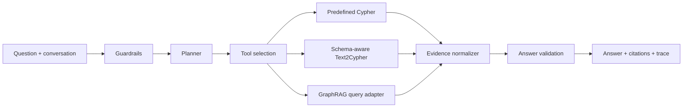

# Architecture

AssistGen Graph Agent has two layers so that a fresh clone is runnable while the production-shaped boundaries remain visible.

## Offline path

`agentic.py` is the reference path that can be executed without third-party packages:

1. `ScopeGuardrail` rejects an empty or clearly out-of-scope question.
2. `SimplePlanner` splits a compound question into a bounded list of tasks.
3. `RuleToolRouter` chooses a deterministic tool so the demo is reproducible.
4. `DocumentSearchTool` uses the in-memory graph and returns only normalized evidence.
5. `AgentRunner` deduplicates citations before the provider sees them.

This path is deliberately small. It is a teaching scaffold, not a claim that keyword routing is sufficient for a production assistant.

## LangGraph path

`workflows/langgraph.py` builds the same stages as a `StateGraph`. It uses lazy imports so the offline path does not require LangGraph. A real deployment can add a checkpointer, stream state updates, use `Send` for bounded task fan-out, and place an `interrupt` before a high-risk tool.

The state is intentionally JSON-shaped: question, tenant context, tasks, selected tools, normalized results, answer and steps. Keeping the state explicit makes retry and replay easier to explain in an interview.

## Structured data and document data

- **Predefined Cypher** handles stable, high-frequency queries. Statements are parameterized and reviewed as code.
- **Text2Cypher** receives the current schema, generates a read-only statement, validates it, runs `EXPLAIN` when configured, and retries with the error as feedback. `ReadOnlyNeo4jAdapter` is a small policy boundary; it is not a replacement for a read-only database account or server-side timeout.
- **GraphRAG** is an optional adapter around an externally built index. It normalizes local/global/DRIFT/basic context into the same citation contract. Microsoft GraphRAG is not vendored into this repository.

The answer layer should receive normalized evidence from all three tools. It should not receive an arbitrary prose string from a tool, because that makes citations and validation impossible to audit.

## What changes in production

The sample uses synthetic data and an in-memory store. A real system would add document ACL filtering before retrieval, a durable database, model and embedding versioning, secret injection, query budgets, structured model output, human approval for writes, and a test set built from authorized documents. These are integration points rather than hidden behavior in the demo.
