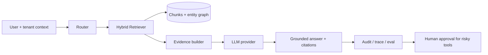

# Architecture

The reference pipeline is intentionally deterministic at the boundaries. A
query is routed to `local`, `global`, or `deep`; retrieval returns hits with a
score and a reason; the evidence builder turns hits into stable citation IDs;
the provider cannot answer without seeing those citations; and the audit span
records tenant and abstention state.

The in-memory graph is a test double, not a claim that an enterprise should
keep all data in process memory. Use PostgreSQL/pgvector for hybrid SQL and
vector retrieval, Neo4j for relationship-heavy traversal, or Microsoft
GraphRAG/LightRAG/KAG as a separately versioned indexer. Keep the
`Document`/`Chunk`/`Citation` contract stable so the query and evaluation
layers do not become coupled to one database.
